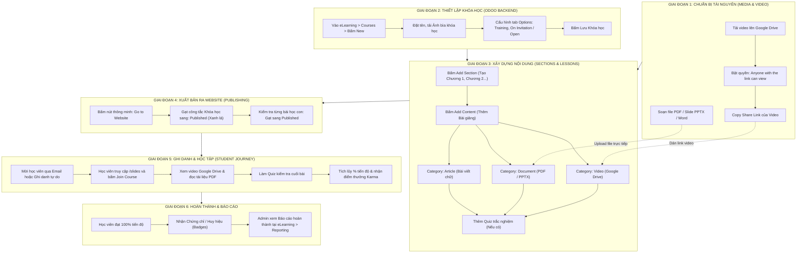
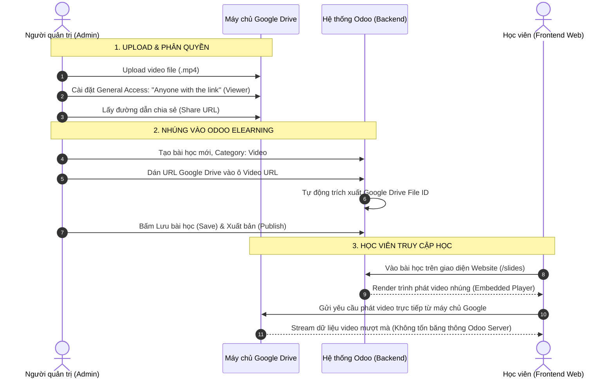
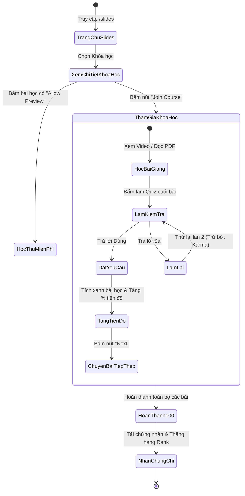

# HƯỚNG DẪN THỰC HÀNH SỬ DỤNG ELEARNING ODOO
## Quy trình Tạo Khóa học, Upload Tài liệu, Lưu/Nhúng Video Google Drive & Publish Website

---

## MỤC LỤC HƯỚNG DẪN
1. [Sơ đồ Luồng Hoạt động Tổng thể (Workflow Diagrams)](#sơ-đồ-luồng-hoạt-động-tổng-thể-workflow-diagrams)
2. [Quy trình 1: Hướng dẫn Tạo Khóa học mới (Course)](#quy-trình-1-hướng-dẫn-tạo-khóa-học-mới-course)
3. [Quy trình 2: Hướng dẫn Upload Tài liệu & Media (PDF, Slide, Word, Excel, Bài viết)](#quy-trình-2-hướng-dẫn-upload-tài-liệu--media-pdf-slide-word-excel-bài-viết)
4. [Quy trình 3: Hướng dẫn Lưu trữ & Nhúng Video Google Drive vào Odoo](#quy-trình-3-hướng-dẫn-lưu-trữ--nhúng-video-google-drive-vào-odoo)
5. [Quy trình 4: Quy trình Xuất bản (Publish) Khóa học ra Website](#quy-trình-4-quy-trình-xuất-bản-publish-khóa-học-ra-website)
6. [Quy trình 5: Mời học viên (Invite) & Kiểm tra trải nghiệm học thực tế](#quy-trình-5-mời-học-viên-invite--kiểm-tra-trải-nghiệm-học-thực-tế)
7. [Bảng tổng hợp các lỗi phổ biến & Cách xử lý ngay lập tức](#bảng-tổng-hợp-các-lỗi-phổ-biến--cách-xử-lý-ngay-lập-tức)

---

## SƠ ĐỒ LUỒNG HOẠT ĐỘNG TỔNG THỂ (WORKFLOW DIAGRAMS)

### 1. Sơ đồ Luồng Vận hành Toàn trình (End-to-End Course Lifecycle):
Sơ đồ mô tả chi tiết toàn bộ các bước từ lúc người quản lý chuẩn bị tài liệu đến khi học viên hoàn thành khóa học:



---

### 2. Sơ đồ Cơ chế Nhúng Video Google Drive (Google Drive Stream & Embed Flow):
Mô tả cách thức Google Drive truyền phát video vào Odoo an toàn mà không bị lỗi quyền truy cập:



---

### 3. Sơ đồ Luồng Trải nghiệm Người học trên Website (Student Learning Experience):



---

## QUY TRÌNH 1: HƯỚNG DẪN TẠO KHÓA HỌC MỚI (COURSE)

### Bước 1.1: Truy cập ứng dụng eLearning
1. Đăng nhập vào giao diện Odoo với tài khoản quản trị (Admin) hoặc người quản lý đào tạo.
2. Trên màn hình chính, nhấp chọn icon ứng dụng **eLearning**.


---

### Bước 1.2: Tạo bản ghi Khóa học mới
1. Trên thanh menu trên cùng, vào **Courses > Courses**.
2. Nhấp nút **New** (Tạo mới) ở góc trên bên trái.

Giao diện tạo khóa học hiển thị như sau:


---

### Bước 1.3: Điền các thông tin quan trọng của Khóa học

#### 1. Thông tin chung:
- **Course Title**: Tên khóa học rõ ràng.  
  *Ví dụ: "Đào tạo Hội nhập Nhân viên mới 2026" hoặc "Hướng dẫn Sử dụng Phần mềm Odoo".*
- **Tags**: Gắn thẻ để học viên dễ tìm kiếm (ví dụ: *Nội bộ, Bán hàng, IT, Nhập môn*).
- **Ảnh bìa (Cover Image)**: Bấm vào biểu tượng chiếc máy ảnh ở góc phải để tải lên ảnh đại diện khóa học (khuyến nghị tỉ lệ 16:9, kích thước 1280x720px).

#### 2. Cấu hình tại tab "Options" (RẤT QUAN TRỌNG):
Chuyển sang tab **Options** để thiết lập đối tượng được phép học:

| Mục cấu hình | Lựa chọn khuyến nghị | Ý nghĩa thực tế |
| :--- | :--- | :--- |
| **Course Type** | **Training** | Khóa học có thanh tiến độ `%`, bắt buộc học tuần tự từng bài và làm bài kiểm tra. (Nếu chỉ là tài liệu đọc tra cứu tự do thì chọn *Documentation*). |
| **Enroll Policy** | **On Invitation** (nếu nội bộ)<br>hoặc **Open** (nếu cộng đồng) | - `Open`: Bất kỳ ai vào web cũng tự bấm "Tham gia" được.<br>- `On Invitation`: Chỉ những ai được Admin thêm vào mới được học. |
| **Show Course To** | **Signed In** hoặc **Course Attendees** | - `Everyone`: Ai cũng thấy (kể cả khách chưa đăng nhập).<br>- `Signed In`: Phải đăng nhập mới thấy.<br>- `Course Attendees`: Chỉ học viên đã được ghi danh mới thấy sự tồn tại của khóa học. |

3. Nhấp nút **Lưu** (biểu tượng đám mây hoặc nút Save).

---

## QUY TRÌNH 2: HƯỚNG DẪN UPLOAD TÀI LIỆU & MEDIA (PDF, SLIDE, WORD, EXCEL, BÀI VIẾT)

Trong khóa học, bài học được tổ chức thành các **Section (Chương/Phần)** và các **Lesson/Content (Bài học con)** bên trong.

```
Khóa học: Quy trình Vận hành Doanh nghiệp
  ├── Section 1: Giới thiệu Tổng quan
  │     ├── Bài 1.1: Video Chào mừng (Video)
  │     └── Bài 1.2: Sơ đồ Tổ chức Công ty (Infographic / Ảnh)
  └── Section 2: Hướng dẫn Chi tiết
        ├── Bài 2.1: Quy chế Lao động (Tài liệu PDF)
        └── Bài 2.2: Chính sách Phúc lợi (Bài viết Article)
```

---

### Bước 2.1: Tạo Chương (Section)
1. Trong form khóa học, tại tab **Content**, nhấp vào **Add Section**.
2. Nhập tên chương (ví dụ: `Chương 1: Kiến thức Căn bản`) rồi nhấn Enter.

---

### Bước 2.2: Upload Tài liệu PDF / Slide PowerPoint / File Word / Excel
1. Nhấp nút **Add Content** ngay dưới Section mong muốn.
2. Cửa sổ tạo bài học xuất hiện:

```
+-----------------------------------------------------------------------------------+
| Content Title: [ Nhập tên bài học...                                           ]  |
| Category: [ Document          v ]                                                 |
| Document Type: (x) File (Upload file trực tiếp)  ( ) Google Drive Document         |
| Attachment: [ Upload your file... (Chọn file PDF / PPTX / DOCX / XLSX) ]         |
| Duration: [ 15 ] Phút       [ ] Allow Preview (Tích nếu cho học thử miễn phí)     |
+-----------------------------------------------------------------------------------+
```


3. **Thiết lập các trường**:
   - **Content Title**: Tên bài học (ví dụ: `Tài liệu Hướng dẫn Quy trình Bán hàng`).
   - **Category**: Chọn **Document**.
   - **Attachment**: Bấm **Upload your file** và chọn file từ máy tính của bạn (hỗ trợ định dạng `.pdf`, `.pptx`, `.docx`, `.xlsx`).
     > *Khuyến nghị:* File PDF là định dạng hiển thị đẹp nhất trên trình duyệt của Odoo vì học viên có thể lật từng trang trực tiếp mà không cần cài thêm phần mềm.
   - **Duration**: Ước tính số phút học viên cần để đọc hết tài liệu (vd: `15` phút).
   - **Allow Download**: Tích chọn nếu cho phép học viên tải file gốc về máy tính.
4. Bấm **Save & Close** (Lưu và Đóng) hoặc **Save & New** (Lưu và tạo tiếp bài khác).

---

### Bước 2.3: Tạo bài giảng dạng Bài viết Tương tác (Article)
Dành cho bài giảng dạng chữ, hình ảnh chèn giữa bài, checklist:
1. Nhấp **Add Content**.
2. Tại mục **Category**, chọn **Article**.
3. Đặt tiêu đề bài viết.
4. Bấm **Save & Close**.
5. Sau khi lưu, bấm vào đường dẫn bài viết để chuyển sang giao diện Website, bấm nút **Edit** (Chỉnh sửa) ở góc phải màn hình để dùng trình kéo thả khối chữ, ảnh, video giống như viết một trang web!

---

## QUY TRÌNH 3: HƯỚNG DẪN LƯU TRỮ & NHÚNG VIDEO GOOGLE DRIVE VÀO ODOO

> **TẠI SAO NÊN DÙNG GOOGLE DRIVE?**  
> Nếu bạn upload trực tiếp file video MP4 (dung lượng 200MB - 1GB) lên Odoo, cơ sở dữ liệu PostgreSQL sẽ bị phình to rất nhanh, gây chậm server và tốn băng thông. Lưu video trên Google Drive và nhúng vào Odoo là giải pháp hoàn hảo: vừa bảo mật, vừa nhẹ máy chủ Odoo!

### Bước 3.1: Upload video lên Google Drive của bạn
1. Mở trình duyệt, truy cập [drive.google.com](https://drive.google.com).
2. Tạo một thư mục riêng (ví dụ: `Video_Khoa_Hoc_Odoo`).
3. Kéo thả file video (`.mp4`, `.mov`, `.mkv`) từ máy tính vào thư mục trên Google Drive và đợi upload hoàn tất (100%).

---

### Bước 3.2: Cài đặt Phân quyền chia sẻ trên Google Drive (BƯỚC QUYẾT ĐỊNH)
Nếu bạn không thực hiện bước này, học viên khi bấm vào bài học sẽ bị màn hình đen báo lỗi: *"Bạn không có quyền truy cập / Yêu cầu quyền truy cập"*.

1. Nhấp chuột phải vào file video vừa tải lên trên Google Drive > chọn **Share (Chia sẻ)** > chọn tiếp **Share (Chia sẻ)**.
2. Tại mục **General access (Quyền truy cập chung)**:
   - Mặc định Google để là: *Restricted (Bị hạn chế)*.
   - Bạn hãy bấm vào và chuyển thành: **Anyone with the link (Bất kỳ ai có đường liên kết)**.
   - Vai trò bên cạnh để là: **Viewer (Người xem)**.
3. Nhấp nút **Copy link (Sao chép đường liên kết)**.
4. Bấm **Done (Xong)**.

```
+-----------------------------------------------------------------------+
|  Share "Bai_Giang_01.mp4"                                             |
|                                                                       |
|  General access                                                       |
|  (*) Anyone with the link  [ Viewer v ]  <--- BẮT BUỘC CHỌN DÒNG NÀY  |
|      Anyone on the Internet with the link can view                    |
|                                                                       |
|  [ Copy link ]                                             [ Done ]   |
+-----------------------------------------------------------------------+
```


Đường link vừa copy sẽ có dạng:  
`https://drive.google.com/file/d/1A2B3C4D5E6F7G8H9I_XYZ/view?usp=sharing`

---

### Bước 3.3: Nhúng Video Google Drive vào Bài học trên Odoo
1. Quay lại trang quản trị Khóa học trên Odoo.
2. Tại tab **Content**, nhấp **Add Content**.
3. Cửa sổ tạo bài học xuất hiện:
   - **Content Title**: Nhập tên bài giảng (ví dụ: `Bài 1: Video Giới thiệu Hệ thống`).
   - **Category**: Chọn **Video**.
   - Tại ô **Video URL (hoặc Document Link)**: Dán chính xác đường link vừa copy từ Google Drive vào ô này.
4. Ngay khi bạn dán link:
   - Odoo sẽ tự động nhận diện nguồn: `Google Drive`.
   - Odoo tự động trích xuất mã định danh file (Google Drive ID) và lấy ảnh bìa đại diện.
5. **Duration**: Nhập thời lượng video (ví dụ video dài 10 phút thì nhập `10`).
6. Bấm **Save & Close**.

```
+-----------------------------------------------------------------------------------+
| Content Title: [ Bài 1: Video Giới thiệu Hệ thống                              ]  |
| Category: [ Video            v ]                                                  |
| Video URL: [ https://drive.google.com/file/d/1A2B3C.../view?usp=sharing        ]  |
| Source Type: Google Drive (Hệ thống tự nhận diện)                                 |
| Duration: [ 10 ] Phút       [x] Allow Preview                                     |
+-----------------------------------------------------------------------------------+
```


---

## QUY TRÌNH 4: QUY TRÌNH XUẤT BẢN (PUBLISH) KHÓA HỌC RA WEBSITE

> **LƯU Ý CỐT TỬ:** Khóa học tạo xong ở backend Odoo mặc định luôn ở trạng thái **Chưa xuất bản (Unpublished)**. Nếu bạn không bấm Publish, học viên khi truy cập website sẽ **không nhìn thấy khóa học**!

Quy trình xuất bản chuẩn gồm **2 cấp độ**:
1. Xuất bản Khóa học (Course level)
2. Xuất bản từng Bài học con (Lesson level)

---

### Bước 4.1: Xuất bản toàn bộ Khóa học (Course)
1. Mở form Khóa học trong backend Odoo.
2. Ở thanh góc trên bên phải của form, nhấp vào nút thông minh: **Go to Website** (Xem trên website).

```
+-----------------------------------------------------------------------+
|  [ Save ]   [ Discard ]      [ Go to Website ]  [ Attendees ]         |
|                              ^^^^^^^^^^^^^^^^^                        |
|                              BẤM VÀO ĐÂY                              |
+-----------------------------------------------------------------------+
```

3. Màn hình sẽ chuyển sang giao diện Website thực tế của khóa học.
4. Nhìn lên góc trên cùng bên phải của thanh công cụ Website, bạn sẽ thấy công tắc hiển thị màu đỏ: **Unpublished**.
5. **Nhấp chuột vào công tắc đó** để chuyển sang màu xanh lá: **Published**.
   - Màu xanh lá **Published**: Khóa học đã chính thức mở trên Website cho học viên thấy!

```
TRƯỚC KHI BẤM (Khóa học đang ẩn):
[ ( ) Unpublished ]  <--- Màu đỏ

SAU KHI BẤM (Khóa học đã mở):
[ (x) Published   ]  <--- Màu xanh lá (HOÀN TẤT)
```

---

### Bước 4.2: Kiểm tra trạng thái xuất bản của từng Bài học (Lesson)
1. Trên giao diện khóa học ở website, nhìn vào danh sách bài học ở cột bên trái:
   - Nếu bài học có nhãn màu đỏ **Unpublished**: Học viên sẽ không xem được bài đó.
   - Nhấp vào bài học đó > gạt công tắc trên thanh công cụ thành **Published**.
2. Đảm bảo tất cả các bài học cần thiết đều ở trạng thái **Published**.

---

## QUY TRÌNH 5: MỜI HỌC VIÊN (INVITE) & KIỂM TRA TRẢI NGHIỆM HỌC THỰC TẾ

### Bước 5.1: Mời học viên vào học (Nếu khóa học đặt chế độ On Invitation)
1. Trong form Khóa học (backend), bấm nút Smart Button **Attendees** (Học viên) ở phía trên.
2. Bấm nút **Add** (Thêm dòng):
   - Chọn tên Nhân viên hoặc Khách hàng trong danh bạ Odoo (`res.partner`).
   - Bấm **Select**.
3. Hoặc bấm nút **Contact Attendees** trên thanh công cụ để gửi email tự động kèm nút bấm *"Bắt đầu học ngay"* gửi thẳng vào hòm thư học viên.

---

### Bước 5.2: Kiểm tra trải nghiệm thực tế dưới góc nhìn học viên
1. Mở một trình duyệt ẩn danh (Incognito Window) hoặc tài khoản học viên.
2. Truy cập vào đường dẫn: `http://<dia-chi-odoo>:8070/slides`
3. Nhấp vào Khóa học vừa tạo:
   - Nhấp nút **Join Course** (Tham gia khóa học).
   - Bấm vào bài học Video Google Drive: Video phải phát mượt mà, có nút chuyển bài khi xem xong.
   - Bấm vào bài học Tài liệu PDF: Trình đọc tài liệu hiển thị rõ ràng từng trang.
   - Thanh tiến độ (Progress bar) tự động tăng `%` khi hoàn thành từng bài.

---

## BẢNG TỔNG HỢP CÁC LỖI PHỔ BIẾN & CÁCH XỬ LÝ NGAY LẬP TỨC

| Hiện tượng lỗi | Nguyên nhân gốc rễ | Cách khắc phục 100% thành công |
| :--- | :--- | :--- |
| **Video Google Drive báo lỗi màn hình xám: "Bạn cần quyền truy cập" (You need access)** | File trên Google Drive vẫn đang để chế độ *"Restricted" (Bị hạn chế)*. | Vào Google Drive > Chuột phải vào file video > Share > Chuyển mục General access thành: **Anyone with the link (Bất kỳ ai có liên kết)** > Lưu lại. |
| **Tạo khóa học xong nhưng học viên vào web `/slides` không thấy** | Quên chưa gạt nút **Published** trên giao diện Website. | Vào khóa học > bấm nút **Go to Website** ở góc trên form > Gạt công tắc từ **Unpublished** (đỏ) sang **Published** (xanh). |
| **Học viên thấy khóa học nhưng không bấm vào bài học xem được** | Bài học con bên trong vẫn đang ở trạng thái **Unpublished**. | Bấm trực tiếp vào bài học con đó trên website > Gạt công tắc bài học sang **Published**. |
| **Dán link Google Drive nhưng Odoo báo không nhận diện được** | Dán sai định dạng link (ví dụ dán link của cả thư mục folder thay vì link của file video cụ thể). | Mở video trên Google Drive > bấm menu 3 chấm > Share > Copy link của **đúng file video đó** (link phải có dạng `.../file/d/<ID>/view...`). |
| **Tài liệu PDF upload lên bị lỗi font chữ tiếng Việt** | File PDF gốc sử dụng font chữ hệ thống không nhúng (Unembedded fonts). | Khi xuất file từ Word/Canva sang PDF, hãy chọn chế độ **Standard PDF** hoặc tích chọn *"Embed all fonts" (Nhúng toàn bộ phông chữ)*. |

---

### TÓM TẮT CHECKLIST TRƯỚC KHI BÀN GIAO KHÓA HỌC:
- [ ] Khóa học đã có tiêu đề, ảnh bìa và mô tả ngắn.
- [ ] Đã chia Section và thêm bài học đầy đủ.
- [ ] Toàn bộ link video Google Drive đã được bật quyền: *"Anyone with the link can view"*.
- [ ] Khóa học đã được bật **Published** (màu xanh lá).
- [ ] Các bài học bên trong đã được bật **Published**.
- [ ] Đã thử mở bằng cửa sổ ẩn danh để kiểm tra video và tài liệu chạy tốt.
